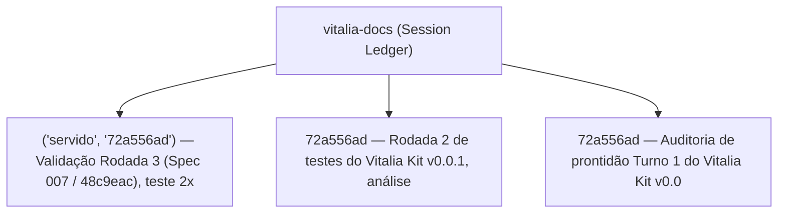

<!-- README.md | Vitalia Kit v0.0.1 | 25-11-2026 20:01(GMT-04:00) -->
**README.md | Vitalia Kit v0.0.1 | 25-11-2026 20:01(GMT-04:00)**

# 🧠 Painel de Contexto — vitalia-docs

> **Vitalia Kit v0.0.1 — Ledger de Memória Persistente e Orquestração Multi-Máquina.**  
> Este repositório armazena o histórico distribuído, decisões arquiteturais, aprendizados consolidados e projeções de grounding das sessões de trabalho do Vitalia Kit.

---

## 📡 Topologia de Shards & Sincronização

---

## 🖥️ Máquinas e Status Atual

<table>
  <thead>
    <tr>
      <th align="left">Máquina / ID</th>
      <th align="left">Tarefa Atual</th>
      <th align="center">Ambiente</th>
      <th align="center">Status</th>
      <th align="left">Último Sync</th>
      <th align="left">Próximo Passo (P0)</th>
    </tr>
  </thead>
  <tbody>
    <tr><td><code>('servido', '72a556ad')</code> (72a556ad)</td><td>Validação Rodada 3 (Spec 007 / 48c9eac), teste 2x install-project append, sincronização documental em vitalia-docs e pacote de handoff Rodada 4 (Spec 008)</td><td align="center"><code>session-end</code></td><td align="center">completed</td><td>25-11-2026 20:00:43(GMT-04:00)</td><td>Executar a Spec 008 no repositório vitalia-kit usando docs/handoff-rodada-4-portao-p03-v0.0.1.md e docs/templates/grounding_audit_template.md (corrigir research.toml, unificar contrato de evidências P03 e aplicar Opção A nos 6 pontos).</td></tr>
    <tr><td><code>—</code> (72a556ad)</td><td>Rodada 2 de testes do Vitalia Kit v0.0.1, análise de GuardianContextV2/data_storage_io/pipeline.json e pacote de handoff para Rodada 3</td><td align="center"><code>dual-repo</code></td><td align="center">completed</td><td>24-11-2026 20:36(GMT-04:00)</td><td>Levar o pacote da Rodada 3 (handoff-rodada-3-vitalia-kit-v0.0.1.md, guias de correção do Memorando/Contratos, dashboard_template_referencia.md e mapa-testes-vitalia-kit.md) para a máquina do vitalia-kit, aplicar correções em source/ e validar T1-T7.</td></tr>
    <tr><td><code>—</code> (72a556ad)</td><td>Auditoria de prontidão Turno 1 do Vitalia Kit v0.0.1 e consolidação documental em vitalia-docs</td><td align="center"><code>dual-repo</code></td><td align="center">completed</td><td>24-11-2026 10:22(GMT-04:00)</td><td>Retestar a nova versão corrigida do Vitalia Kit v0.0.1 (Turno 2) validando os itens do handoff e, após estabilização do código, reconciliar docs/CONTRATOS_WORKFLOWS_SDD.md.</td></tr>
  </tbody>
</table>

---

## 🎯 Sessão Ativa em Destaque

- **Máquina:** `('servido', '72a556ad')` (`72a556ad`)
- **Shard ID:** `72a556ad_25112026200043_68afb5`
- **Tarefa:** Validação Rodada 3 (Spec 007 / 48c9eac), teste 2x install-project append, sincronização documental em vitalia-docs e pacote de handoff Rodada 4 (Spec 008)
- **Status:** `completed` | **Último Sync:** `25-11-2026 20:00:43(GMT-04:00)`
- **Próximo Passo (P0):** Executar a Spec 008 no repositório vitalia-kit usando docs/handoff-rodada-4-portao-p03-v0.0.1.md e docs/templates/grounding_audit_template.md (corrigir research.toml, unificar contrato de evidências P03 e aplicar Opção A nos 6 pontos).

---

## 📚 Histórico, Decisões, Aprendizados & Guard Rails

<strong>🔍 Clique para expandir o Histórico Completo de Sessões</strong>

 

- **`25-11-2026 20:00:43(GMT-04:00)`** — `('servido', '72a556ad')` (`72a556ad_25112026200043_68afb5`): Validação Rodada 3 (Spec 007 / 48c9eac), teste 2x install-project append, sincronização documental em vitalia-docs e pacote de handoff Rodada 4 (Spec 008) *(Próximo: Executar a Spec 008 no repositório vitalia-kit usando docs/handoff-rodada-4-portao-p03-v0.0.1.md e docs/templates/grounding_audit_template.md (corrigir research.toml, unificar contrato de evidências P03 e aplicar Opção A nos 6 pontos).)*
- **`24-11-2026 20:36(GMT-04:00)`** — `—` (`72a556ad_20261124_2036`): Rodada 2 de testes do Vitalia Kit v0.0.1, análise de GuardianContextV2/data_storage_io/pipeline.json e pacote de handoff para Rodada 3 *(Próximo: Levar o pacote da Rodada 3 (handoff-rodada-3-vitalia-kit-v0.0.1.md, guias de correção do Memorando/Contratos, dashboard_template_referencia.md e mapa-testes-vitalia-kit.md) para a máquina do vitalia-kit, aplicar correções em source/ e validar T1-T7.)*
- **`24-11-2026 10:22(GMT-04:00)`** — `—` (`72a556ad_20261124_1022`): Auditoria de prontidão Turno 1 do Vitalia Kit v0.0.1 e consolidação documental em vitalia-docs *(Próximo: Retestar a nova versão corrigida do Vitalia Kit v0.0.1 (Turno 2) validando os itens do handoff e, após estabilização do código, reconciliar docs/CONTRATOS_WORKFLOWS_SDD.md.)*

<strong>⚖️ Clique para expandir as Decisões Arquiteturais Consolidadas</strong>

 

| Máquina (ID) | Decisão Arquitetural | Impacto / Racional |
| :--- | :--- | :--- |
| `72a556ad` | Formalizar ADR-0014 em MEMORANDO DE ARQUITETURA.md e congelar CONTRATOS_WORKFLOWS_SDD.md até a validação do Turno 2 sobre a versão corrigida do Vitalia Kit. | Evitar retrabalho em manual de ~4.000 linhas enquanto a spec de correções estabiliza código, prompts e flags CLI. |
| `72a556ad` | Descontinuar .vitalia/pipeline.json e .vitalia/pipe.json em definitivo; o transporte de estado em filesystem opera via data_storage/context/, data_storage/handoffs/ e payloads transitórios em .vitalia/. | Nenhum script Python em src/ consome pipe.json ou pipeline.json; o controle de estado entre etapas já foi resolvido pelos envelopes de contexto e handoffs. |
| `72a556ad` | Erradicar .vitalia/session/data (zero tolerância), unificar renderização de dashboards em componente único orientado a templates (foco Rodada 3 no session_repo/README.md) e restringir GuardianContextV2 ao resgate direto de phase_guardrails e phase_profiles. | Evitar inchaço de escopo na Rodada 3, garantindo primeiro o painel rico de sessão e a restauração estrutural de GuardianContextV2, deixando expansão de phase_profiles para spec futura. |
| `72a556ad` | Adotar Opção A em todos os 6 pontos de alinhamento com RASCUNHO_PORTAO_GROUNDING_P03.md mais correção obrigatória dos Achados Extras A (research.toml) e B (contrato de evidências P03), consolidando o pacote da Rodada 4 (Spec 008) em vitalia-docs antes de alterar source/. | Preservar P01 (SDD Pipeline Inviolability) e entregar um pacote completo e visualmente refinado (grounding_audit_template.md + handoff-rodada-4-portao-p03-v0.0.1.md) para a Spec 008 no repositório vitalia-kit. |

<strong>💡 Clique para expandir os Aprendizados Consolidados</strong>

 

| Máquina (ID) | Categoria | Aprendizado | Racional |
| :--- | :---: | :--- | :--- |
| `72a556ad` | `KIT` | A auditoria comparativa com kit_src, vitalia-kit/source e execução real em sandbox isolado revelou discrepâncias de caminhos (Camada 3), validadores ausentes em constitution.yaml e divergência entre CONTRATOS_WORKFLOWS_SDD.md e os TOMLs/GPs compilados. | Testes executados diretamente no runtime isolado e com repositórios GitHub reais expõem falhas de integração (ex.: históricos Git divergentes e imports sem sys.path) invisíveis em testes unitários mockados. |
| `72a556ad` | `KIT` | Alterações em source/layers/ (gp_*.yaml, constitution/base.yaml, extensions/*.toml) são a única fonte de verdade compilada por vitalia_layer_compiler.py; editar profiles/ ou extensions/ compilados gera deriva, e achatar chaves (phase/role/guardrails sem phase_guardrails) silencia GuardianContextV2 com {}. | Auditoria direta em git@github.com:andreticba/vitalia-kit.git e execução real do hook brainstorming.toml mostraram phase_guardrails: {} e phase_profiles: {} vazios no envelope. |
| `72a556ad` | `KIT` | A inspeção direta do código-fonte revelou defeitos invisíveis via --help: research.toml com prompt de Revisor Científico (recursão infinita) e incompatibilidade de nomes de campos entre evidence_record.schema.json, vitalia_grounding_validator.py --mode evidence e grounding_audit_renderer.py. | Validar contratos reais lendo o código e schemas em conjunto evita falsos positivos de prontidão quando testes unitários mockam campos divergentes. |

<strong>🛡️ Clique para expandir os Guard Rails de Grounding e Domínios</strong>

 

| Projeção | Status | Domínios Projetados | Pendentes de Curadoria HITL |
| :--- | :---: | :--- | :---: |
| [GROUNDING_DOMAINS.md](./GROUNDING_DOMAINS.md) | Ativo | `security_practices`, `software_architecture`, `design_patterns`, `general_web`, `clinical_safety`, `regulations_compliance`, `python_packages`, `provedores_de_ia`, `web_frameworks`, `javascript_ecosystem`, `devops_ci`, `cloud_services` | `0` pendentes |

<strong>🗄️ Clique para expandir o Resumo Numérico da Camada 3 (`data_storage`)</strong>

 

| Categoria | Itens Registrados |
| :--- | :---: |
| `context` | 10 |
| `handoffs` | 0 |
| `diagnostics` | 0 |
| `research` | 0 |
| `backups` | 0 |
| `telemetry` | 0 |
| `grounding_decisions` | 0 |

---

Painel gerado automaticamente pelo motor de contexto do Vitalia Kit (<code>vitalia_context_engine.py --action consolidate</code>).

